# Kyles Sofle

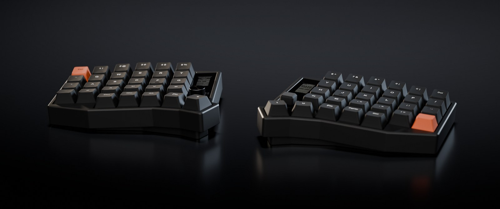

ZMK config for a wireless Eyelash Sofle with a nice!view screen on each half. A Mac sends the left
screen the time, Claude Code usage, GitHub Actions results and the next calendar event. The right
screen shows the keys on the held layer and runs Tetris. It advertises as Kyles Sofle
(`config/eyelash_sofle.conf`).

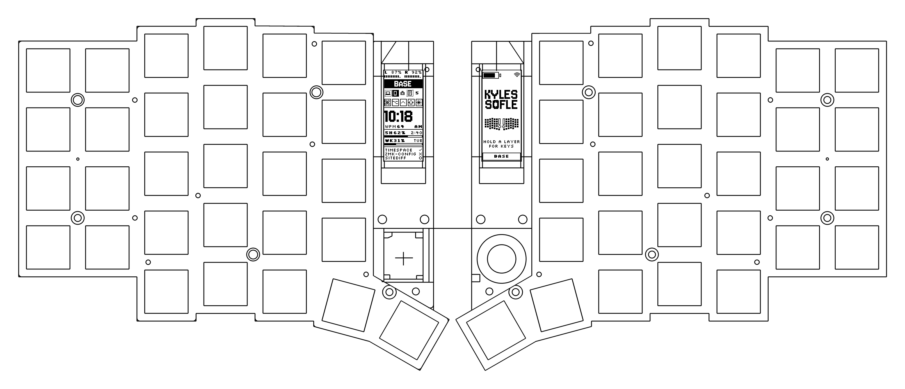

[](https://github.com/kylephillipsau/zmk-config-sofle/actions/workflows/build.yml)

The screen images come from the same code and fonts as the firmware's screen art.

## Left screen

<table>
  <tr>
    <td align="center">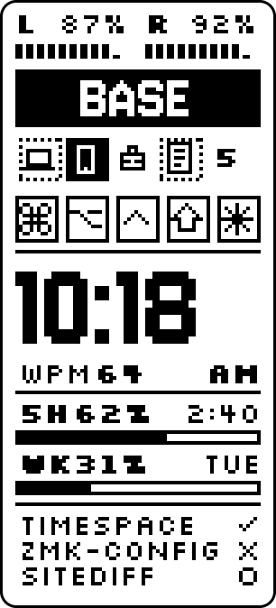</td>
    <td align="center">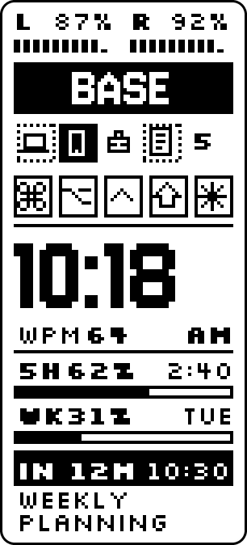</td>
    <td align="center">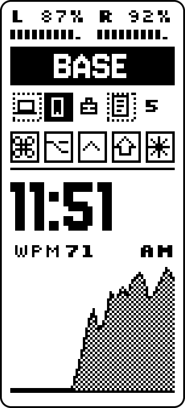</td>
  </tr>
  <tr>
    <td align="center">Usage and CI</td>
    <td align="center">Next meeting</td>
    <td align="center">Without the Mac</td>
  </tr>
</table>

- Batteries for both halves, the active layer, five Bluetooth slots with an icon per device, and
  badges for held modifiers. The ✳ badge lights while a Claude Code session is working or waiting
  for input.
- The clock is set by the Mac on each connection and keeps time between syncs. It's 12-hour unless
  `CONFIG_NICE_VIEW_LEGEND_CLOCK_24H=y`.
- Claude usage shows the percent used of the 5 hour and weekly limits, as numbers and bars, with
  reset times. 100% shows as MAX.
- The three repos where a Claude Code session most recently started or got a prompt show their
  latest GitHub Actions result: ✓ passed, ✗ failed, ○ running, and nothing for no CI.
- From 30 minutes before a calendar event until 15 minutes after it starts, or its end if sooner,
  the event replaces the repo rows. It counts down by the minute ("IN 12M", then "NOW") beside the
  start time, with the title over two lines.
- The card needs a frame from the Mac in the last 15 minutes (it resends every 10) over the
  connection in use. On another Bluetooth slot, or once the Mac sleeps, a WPM chart takes its place.

## Right screen

<table>
  <tr>
    <td align="center">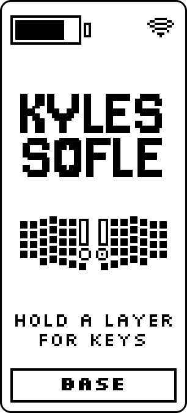</td>
    <td align="center">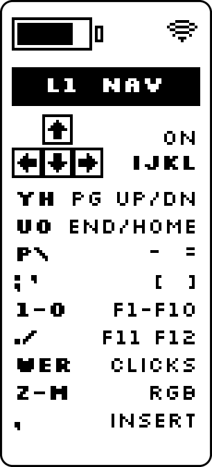</td>
    <td align="center">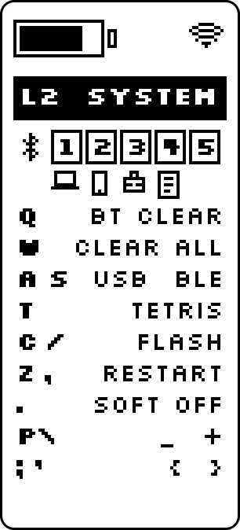</td>
  </tr>
  <tr>
    <td align="center">Idle</td>
    <td align="center">NAV held</td>
    <td align="center">SYSTEM held</td>
  </tr>
</table>

Holding NAV or SYSTEM shows that layer's keys, as the left half sends the right half the active
layer. When idle, the screen shows the keyboard's name over a drawing traced from the vendor's plate
drawing.

## Tetris

<table>
  <tr>
    <td align="center">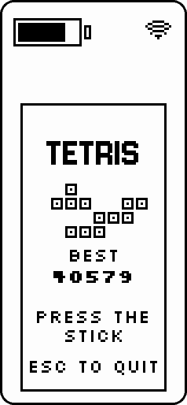</td>
    <td align="center">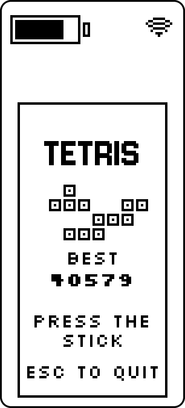</td>
    <td align="center">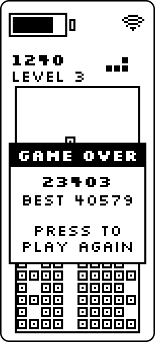</td>
  </tr>
</table>

Hold SYSTEM and tap T to turn on the GAME layer, and play with the joystick. Left and right move, up
rotates, down soft drops, and pressing the stick hard drops. While the layer is on, the stick only
plays the game. Esc leaves the layer, which pauses the game. The game uses a 7-piece bag and the
original game's speeds and scoring, and the best score survives restarts. The clip above is a game
played by the firmware's rules on a Mac.

## How the Mac talks to the keyboard

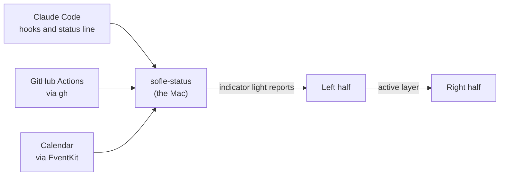

`host/sofle-status` sends data over the keyboard's indicator lights. macOS sends each keyboard a
byte of light states, and any app can send the same report, so the tool uses the lights macOS
doesn't. With Num Lock off, Scroll Lock and Compose carry two Claude Code flags. With Num Lock on,
each report carries two bits of a frame: the time, the usage limits, a repo row or the next event,
with a CRC. The keyboard drops damaged frames, and the Mac sends them again later.

Over Bluetooth, an idle keyboard listens only every 30th radio interval, so a report can wait up to
about 360 ms. While frames arrive, the left half asks the Mac for latency 0, then restores it, so a
card arrives in a few seconds without raising idle power use.

A Windows PC can feed the same screen with `host/windows`, a Rust port of the tool. Windows won't
let an app set a keyboard's lights, so it sends the same reports, up to 32 at a time, through a
second, vendor-defined HID interface on the left half. The calendar isn't on Windows yet.

[KYLES_SOFLE.md](KYLES_SOFLE.md) covers the frame format, the data sources, the Windows port and the
Tetris rules.

## Keymap

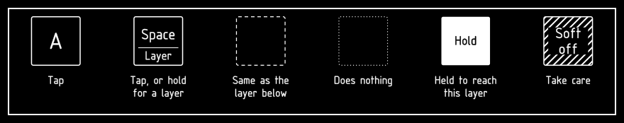

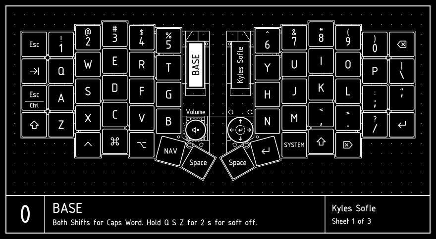
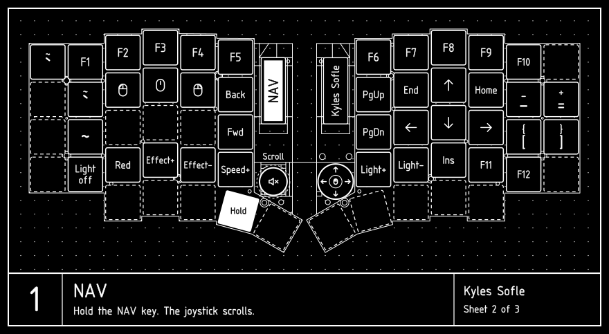
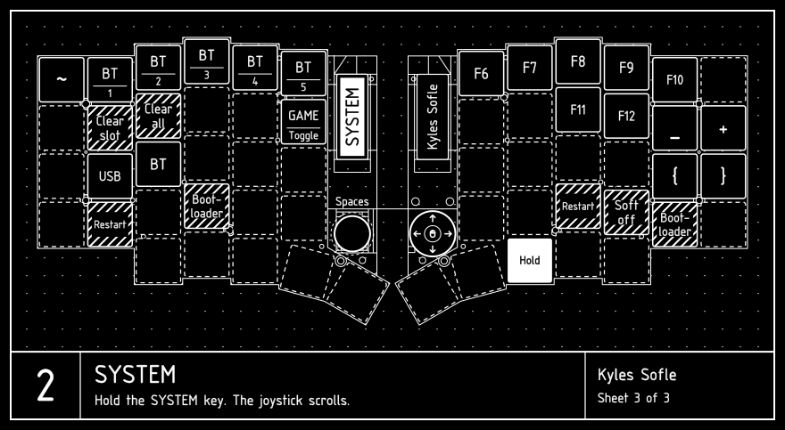

- Caps Lock is Esc on a tap and Ctrl on a hold. Both Shifts together turn on Caps Word.
- The joystick sends arrows, and scrolls both ways on NAV and SYSTEM, reversed to suit macOS natural
  scrolling. [DYA Studio](https://studio.dya.cormoran.works/) tunes the scroll speed live.
- The knob changes the volume, scrolls on NAV, and switches Spaces and full-screen apps
  (Ctrl+Left and Right) on SYSTEM.
- NAV + X turns the underglow on in solid red.
- The Bluetooth slots are 1 Mac, 2 phone, 3 work computer and 4 Boox tablet, shown as icons on both
  screens (`SLOT_ICONS` in `art/concepts.py`). A device takes whichever slot was selected when it
  paired.

The GAME layer isn't drawn, as it only changes the joystick. Keys sit in their real positions, from
the plate drawing in `art/sofle_outline.json`. To redraw the sheets:

```sh
uvx --from keymap-drawer keymap -c keymap_drawer.config.yaml parse -z config/eyelash_sofle.keymap > keymap-drawer/eyelash_sofle.yaml
uv run keymap-drawer/draw.py keymap-drawer/blueprint.yaml
```

## Build and flash

```sh
./build.sh            # both halves, in Docker, to firmware/kyles_sofle_{left,right}.uf2
./build.sh left       # one target: left, right or reset
./build.sh update     # re-run west update after editing config/west.yml
./flash.sh left       # then double-press the left half's reset button
./flash.sh right
host/install.sh       # the Mac side: Sofle Status.app and its launch agent
host\windows\install.ps1   # the Windows side: sofle-status.exe and its agent
```

The west workspace lives in the `zmk-sofle-ws` Docker volume, and GitHub Actions builds the same
targets from `build.yaml` on every push. Both halves mount as `NICENANO` in flashing mode.
`flash.sh` remembers each half's USB serial number after its first flash and won't put one half's
firmware on the other. Keymap and left-screen changes only need the left half, and right-screen art
needs the right.

## Repository layout

| Path | What it is |
|---|---|
| `config/` | the keymap and keyboard settings |
| `boards/shields/nice_view_legend/` | both screens: `widgets/status.c` (left), `widgets/peripheral_status.c` and `widgets/tetris.c` (right), the decoder for the Mac's frames in `widgets/host_link.c` |
| `host/` | `sofle-status`, the Mac side, and tests that run the firmware's decoder and Tetris rules on the Mac |
| `host/windows/` | `sofle-status` for Windows, in Rust, with a test that runs the firmware's decoder on what it sends |
| `art/` | the screen designs, and the scripts that turn them into firmware art, fonts and these images |
| `docs/` | these images and the [seller's notes](docs/seller-notes.md) |

The frame decoder and the Tetris rules are plain C with no ZMK dependencies, tested on the Mac: the
decoder against thousands of damaged transfers, the rules over 5,200 games. After a crash, the
firmware reboots and shows the cause on the left screen.

## Renders

<table>
  <tr>
    <td align="center" colspan="2">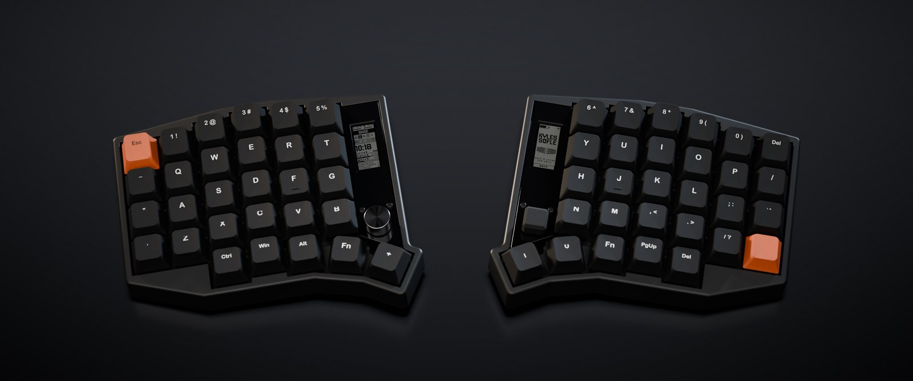</td>
  </tr>
  <tr>
    <td align="center">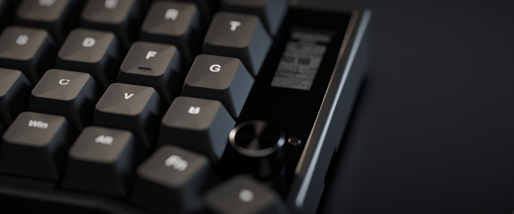</td>
    <td align="center">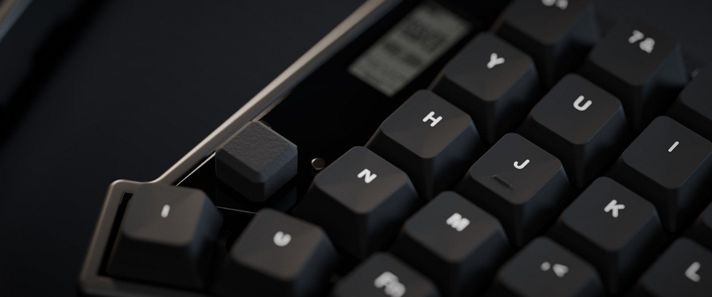</td>
  </tr>
  <tr>
    <td align="center">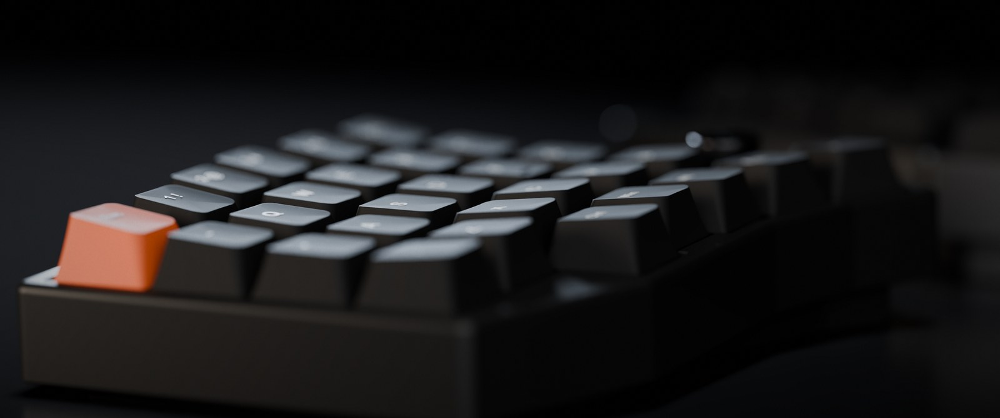</td>
    <td align="center">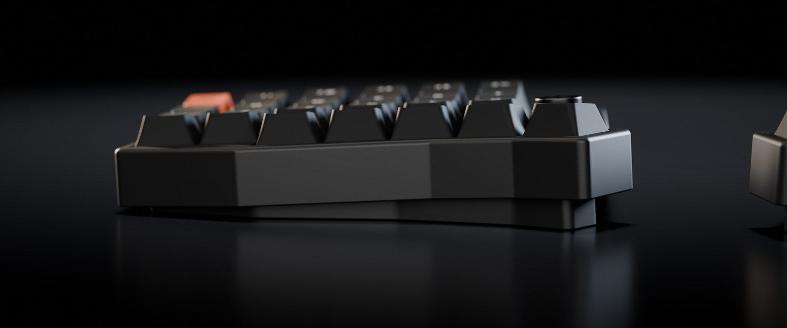</td>
  </tr>
</table>

Rendered in Blender from the seller's 3D models of the MX Sofle: the original case, the acrylic strip
over the controller, and the angled pad under each half that raises its inner edge.

## Credits

- The keyboard and its original config are from
  [a741725193/zmk-sofle](https://github.com/a741725193/zmk-sofle), kept as the `upstream` remote.
  The plate drawing comes from the seller's case files.
- [ZMK](https://zmk.dev), through [cormoran's fork](https://github.com/cormoran/zmk) for split relay
  events and DYA Studio, on [Zephyr](https://zephyrproject.org) and [LVGL](https://lvgl.io).
- Fonts: [Silkscreen](https://github.com/googlefonts/silkscreen) and
  [Jersey 10](https://github.com/scfried/soft-type-jersey), under the SIL Open Font License
  (`art/fonts/LICENSES`).
- [keymap-drawer](https://github.com/caksoylar/keymap-drawer) parses the keymap, and
  `keymap-drawer/draw.py` draws it.
- [osifont](https://github.com/hikikomori82/osifont) is the lettering on the keymap drawings.
