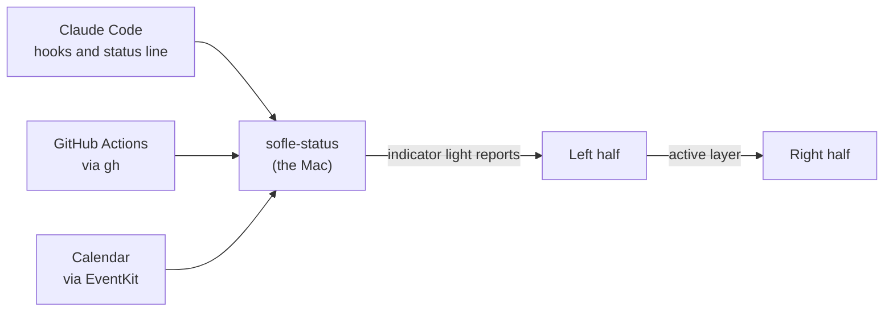

# Kyles Sofle

ZMK config for a wireless Eyelash Sofle with a nice!view screen on each half. A Mac sends the left
screen the time, Claude Code usage, GitHub Actions results and the next calendar event. The right
screen shows the keys on the held layer and runs Tetris.


[](https://github.com/kylephillipsau/zmk-config-kyles-sofle/actions/workflows/build.yml)

The screen images are generated by the same code and fonts as the firmware's screen art.

## Left screen

<table>
  <tr>
    <td align="center"></td>
    <td align="center"></td>
    <td align="center"></td>
  </tr>
  <tr>
    <td align="center">Usage and CI</td>
    <td align="center">Next meeting</td>
    <td align="center">Without the Mac</td>
  </tr>
</table>

- Batteries for both halves, the active layer, five Bluetooth slots with an icon per device, and
  badges for held modifiers. The ✳ badge lights while a Claude Code session is working or waiting
  for input.
- The clock is set by the Mac on each connection and keeps time between syncs.
- Claude usage shows the 5 hour and weekly limits as bars, with reset times. 100% shows as MAX.
- GitHub Actions status for the three repos where a Claude Code session most recently started or
  got a prompt: ✓ passed, ✗ failed, ○ running.
- From 30 minutes before a calendar event until 15 minutes after it starts, the event replaces the
  repo rows and counts down by the minute.
- On another Bluetooth slot, or after 15 minutes without data from the Mac, a WPM chart replaces
  the card.

## Right screen

<table>
  <tr>
    <td align="center"></td>
    <td align="center"></td>
    <td align="center"></td>
  </tr>
  <tr>
    <td align="center">Idle</td>
    <td align="center">NAV held</td>
    <td align="center">SYSTEM held</td>
  </tr>
</table>

Holding NAV or SYSTEM shows that layer's keys. The left half sends the active layer to the right
half. When idle, the screen shows a drawing of the keyboard traced from the vendor's plate drawing.

## Tetris

<table>
  <tr>
    <td align="center"></td>
    <td align="center"></td>
    <td align="center"></td>
  </tr>
</table>

Hold SYSTEM and tap T to play with the joystick. Left and right move, up rotates, down soft drops,
and pressing the stick hard drops. Esc quits. The game uses a 7-piece bag and the original game's
speeds and scoring, and saves the best score. The clip is a game played by the firmware's rules on
a Mac.

## How the Mac talks to the keyboard



`host/sofle-status` sends data over the keyboard's indicator lights. macOS sends each keyboard a
byte of light states, and any app can send the same report. The tool uses the lights macOS doesn't.
With Num Lock off, Scroll Lock and Compose carry two Claude Code flags. With Num Lock on, each
report carries two bits of a frame: the time, the usage limits, a repo row or the next event, with
a CRC. The keyboard drops damaged frames, and the Mac sends them again later.

Over Bluetooth, ZMK lets the keyboard skip up to 30 radio intervals while idle, so a report can wait
about 360 ms. While frames arrive, the left half asks the Mac for latency 0, then restores it, so a
card arrives in a few seconds without raising idle power use.

A Windows PC can feed the same screen with `host/windows`, a Rust port of the tool. Windows won't
let an app set a keyboard's lights, so it sends the same reports, up to 32 at a time, through a
second, vendor-defined HID interface that the left half also has. The calendar isn't on Windows
yet.

[KYLES_SOFLE.md](KYLES_SOFLE.md) documents the frame format and the data sources.

## Keymap


- Caps Lock is Esc on a tap and Ctrl on a hold. Both Shifts together turn on Caps Word.
- The joystick sends arrows, and scrolls in both directions on NAV and SYSTEM.
- The knob changes the volume, scrolls on NAV, and switches Spaces on SYSTEM.
- NAV + X turns the underglow on in solid red.

## Build and flash

```sh
./build.sh            # both halves, in Docker (ZMK's build image)
./flash.sh left       # then double-press the left half's reset button
./flash.sh right
host/install.sh       # the Mac side: Sofle Status.app and its launch agent
host\windows\install.ps1   # the Windows side: sofle-status.exe and its agent
```

Both halves mount as `NICENANO` in flashing mode. `flash.sh` tells them apart by USB serial number
and won't flash the wrong half.

## Repository layout

| Path | What it is |
|---|---|
| `config/` | the keymap and keyboard settings |
| `boards/shields/nice_view_legend/` | both screens: `widgets/status.c` (left), `widgets/peripheral_status.c` and `widgets/tetris.c` (right), the decoder for the Mac's frames in `widgets/host_link.c` |
| `host/` | `sofle-status`, the Mac side, and tests that run the firmware's decoder and Tetris rules on the Mac |
| `host/windows/` | `sofle-status` for Windows, in Rust, with a test that runs the firmware's decoder on what it sends |
| `art/` | the screen designs, and the scripts that turn them into firmware art, fonts and these images |
| `docs/` | these images and the [seller's notes](docs/seller-notes.md) |

The frame decoder and the Tetris rules are plain C with no ZMK dependencies, tested on the Mac: the
decoder against thousands of damaged transfers, the rules over 5,200 games. After a crash, the
firmware reboots and shows the cause on the left screen.

## Credits

- The keyboard and its original config are from [a741725193/zmk-sofle](https://github.com/a741725193/zmk-sofle);
  the plate drawing comes from the seller's case files.
- [ZMK](https://zmk.dev), through [cormoran's fork](https://github.com/cormoran/zmk) for split relay
  events and DYA Studio, on [Zephyr](https://zephyrproject.org) and [LVGL](https://lvgl.io).
- Fonts: [Silkscreen](https://github.com/googlefonts/silkscreen) and
  [Jersey 10](https://github.com/scfried/soft-type-jersey), under the SIL Open Font License
  (`art/fonts/LICENSES`).
- [keymap-drawer](https://github.com/caksoylar/keymap-drawer) draws the keymap.
